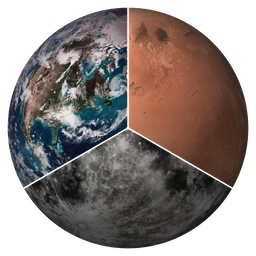

<p align="center"></p>

# Analog Atlas — find the places on Earth that behave like the Moon and Mars

NASA Space Apps Challenge 2026 · *Identify Earth Locations that Analog the Permanent Moon Base Locations and Mars*

Pick a region on the Moon or Mars. Analog Atlas turns it into a **planet-independent feature vector** and ranks Earth
by **physical similarity (SI, 0–100)**. Every result says what is similar (the two strongest feature families), where the
analogy breaks (features with the largest normalised differences, with both values), which sources back it, and what
Earth can never reproduce (gravity, pressure, radiation, day length, shown but never scored).

The goal is not to rediscover Antarctica, Atacama, Iceland and Hawaii. The method is first **anchored** on analogs the
literature already trusts, then used to **discover** comparable places nobody has used yet, with the Global South treated
as a **priority, never a filter**.

## Why the Global South

We compiled 41 natural-site analog field campaigns, one cited source each (`backend/data/campaigns.csv`).
**19 of the 22 NASA-involved campaigns (86 %) took place in high-income countries.** The only two in developing
countries are upper-middle income (Apollo training at Pinacate, Mexico; the Mars 2020 team at Lake Salda, Türkiye).
**No space agency has run a field analog campaign in a low-income country.** Search coverage and caveats:
`docs/campaigns_summary.md`.

## Method

**Features: 24 numeric + a landform class, in 8 families.** Single source of truth: `backend/config/features.json`
(the frontend mirrors it).

| Family | Features |
|---|---|
| Topography | slope mean, slope σ, roughness, local relief (5 km), crater / pit density |
| Surface | albedo, thermal inertia as a percentile on its own planet, rock abundance |
| Thermal & light | minimum surface temperature, day–night swing, time below 0 °C, noon sun elevation |
| Water & ice | aridity, near-surface ground ice |
| Mineralogy | olivine, pyroxene, plagioclase, evaporite / sulfate, Fe-oxide, clay, carbonate |
| Processes & bio | dust / aeolian activity, vegetation cover |
| Subsurface | caves, lava tubes, pits |
| Landform | genetic class with a documented affinity matrix (e.g. mare plain ↔ flood basalt 0.8) |

There is no absolute elevation: height above a datum means nothing across planets.

**Similarity:** `SI = 100 · (1 − √(Σ w·Δ² / Σ w))`, where Δ is the difference after scaling each feature by a
**fixed physical range** (e.g. slope 0–30°, minimum temperature −240…30 °C). The ranges never come from the catalog or
the grid, so a site's score cannot change because other sites were added; a test enforces this. The distance is a
weighted Euclidean (RMS) distance, **not cosine**, because cosine ignores magnitude: on 0–1 data (0.1, 0.1) and
(0.9, 0.9) would look identical. Missing features drop out of both sums, and `coverage` reports how much of the weight
had data. Four mission profiles (landing, resource, habitat, science) set the family weights.

**Anchor & Discover**
- *Anchors*: the 16 literature sites ranked by pure SI. The anchor pairs were frozen before the first validation run
  (`backend/config/anchors.json`): Jezero → Lake Salda, Cerberus → McCartys and Laki, Gale → Mauna Kea hematite ridge,
  Shackleton → Haughton, Marius → San Francisco Volcanic Field.
- *Discoveries*: a global ~50 km Earth grid built with Google Earth Engine and scored the same way, grouped into 150 km
  regions. Each region comes with its size, mean SI, percentile among all land cells, and reasons.

**Priority, not filter:** `opportunity = SI + bounded point bonuses`, applied only when SI ≥ 60. SI is always shown next
to it. The bonuses are:
- income group (World Bank: LIC +10, LMC +7, UMC +4);
- novelty, up to +5, from the distance to the nearest past analog campaign (full at 500 km);
- access, up to +3, from travel time to the nearest city.

A candidate can only overtake one that is at most its total bonus better. Nothing is ever removed: places more than
48 h away are flagged "hard access", and places within 50 km of a past campaign or a catalog site are flagged
"known nearby". Discovery selection is set in `backend/config/priority.json`. In `quota` mode (the current default),
at least 10 of the top 20 discoveries are Global South regions and the other 10 are the best by pure SI. In `bonus` mode
the list is ordered by opportunity alone.

## Validation

16-site catalog, pure SI, best anchor rank per target. Five targets; Imbrium and Tharsis have no sourced anchor and are
excluded.

| Profile | hit@1 | hit@3 | hit@5 | MRR | random hit@5 |
|---|---|---|---|---|---|
| landing | 2/5 | 4/5 | 5/5 | 0.61 | 0.31 |
| resource | 3/5 | 4/5 | 5/5 | 0.74 | 0.31 |
| habitat | 3/5 | 3/5 | 5/5 | 0.70 | 0.31 |
| science | 3/5 | 4/5 | 4/5 | 0.73 | 0.31 |

Jezero → Lake Salda ranks 1st under every profile. The one miss is Gale → Mauna Kea under the science profile (rank 7):
Mauna Kea matches the hematite but not Gale's sedimentary, lacustrine setting. **Honest caveat:** the target and site
vectors are literature estimates and the catalog is small, so this is a sanity check, not proof.

A harder test is frozen in `backend/config/discovery_checklist.json`: 10 literature candidates outside our catalog and
campaign list (Chad, Iran, Libya, India ×3, Ghana, Egypt, Namibia, China). Once the global grid exists,
`check-discoveries` reports how many of them fall in the top 10 % of all land cells, compared with a random-point
baseline. Jingpo (China) turned out to host a 2025 Peking University lava-tube base, so it is reported separately and
not counted as novel.

## Data

| Layer (Earth grid) | Source | Tier |
|---|---|---|
| slope (mean, σ), local relief | NASADEM (NASA/NASADEM_HGT/001) | measured |
| minimum temperature, day–night swing, time below 0 °C | MODIS MOD11A2 LST, 2019–2023 | measured / derived |
| albedo | MODIS MCD43A3 | measured |
| thermal inertia (apparent, percentile over Earth land) | MODIS LST + albedo | derived |
| aridity | GPM IMERG monthly V07 precipitation / TerraClimate PET | derived |
| dust activity (percentile) | MERRA-2 aerosol optical depth (DUEXTTAU) | derived |
| vegetation | MODIS MOD13A2 NDVI | derived |
| olivine / pyroxene, carbonate | ASTER GED emissivity indices (Ninomiya) | **proxy** |
| Fe-oxide, clay | Sentinel-2 band ratios — optional; **not used** in the 50 km global run (`--no-s2`) | **proxy** |
| ground ice | permafrost from mean land-surface temperature | **proxy** |
| roughness, crater density, rock abundance, plagioclase, evaporite, caves, landform | no calibrated global layer yet; missing on the grid, skipped by the scorer (coverage is reported) | — |
| access (bonus input only) | Malaria Atlas Project accessibility to cities 2015 (`projects/malariaatlasproject/assets/accessibility/accessibility_to_cities/2015_v1_0`) | measured |
| Moon / Mars imagery | NASA Trek WMTS (LRO WAC, Viking MDIM 2.1) plus a dynamic high-resolution viewport export | — |

Roughness was dropped from the grid after the smoke test: the 90 m terrain-ruggedness window collapses to 0 when the
stack is reduced at 1 km, which would have biased every Earth cell. PET comes from TerraClimate, not MOD16A2, because MOD16 masks barren land and deserts, which is exactly where many
candidates lie. Every layer carries a tier badge in the app: M = measured, D = derived, P = proxy.

## Limitations

- Moon and Mars relief in the browser is a seeded model for visualisation. The target vectors are literature estimates.
- Catalog values are literature estimates. Mineral proxies on the Earth grid are rough and uncalibrated.
- Earth cannot reproduce gravity, vacuum or thin atmosphere, radiation, or day length. These are shown, never scored.

## Run it

**One click, no terminal:** double-click `start.bat` (Windows) or run `./start.sh`. It starts one local server on
http://127.0.0.1:8000/ and opens the Atlas there. On that origin the Atlas finds its API by itself (live discoveries), and
the **Data pipeline** button in the top bar opens a drawer over the globe that runs every backend step in the background:
Earth Engine sign-in, smoke test, global export, CSV upload and merge, discovery checks and the offline snapshot, with a
progress track and live logs. Opened from disk or from GitHub Pages, the Atlas works as before, using the local engine
and the embedded snapshot.

```bash
# Frontend: one self-contained file. Serve it over HTTP; opened via file:// it falls back to the 2D view.
python -m http.server 8765        # open http://localhost:8765/index.html  (add ?api=https://your-api for live discoveries)

# Backend
cd backend
pip install -r requirements.txt
python -m unittest discover -s tests -v      # 36 tests (server tests need fastapi + httpx)
python -m analog_atlas.cli validate
python -m analog_atlas.cli demo --target jezero --profile science --top 3
python -m analog_atlas.cli find --target cerberus --profile landing
uvicorn analog_atlas.api:app --port 8000     # POST /find-analogs, POST /score
```

The Earth Engine extraction, merge and offline snapshot are described in `docs/RUN_EARTH_ENGINE.md`. Running
`export-offline --embed ../index.html` lets the demo show real discoveries even when the API is down.

**Rebuilding `index.html`.** `index.html` is the deliverable. Small source files are injected into it by idempotent scripts,
run from the repository root in this order: `python brand/apply_logo.py index.html` (logo), `python tools/add_pipeline.py`
(the Data pipeline drawer, shown only when the local server answers), `python tools/add_polish.py` (phone layout and the
"Loading planetary imagery…" indicator). Edit `tools/pipeline_drawer.html` / `tools/polish.html`, not `index.html`.

**Deploy.** The repository root (`index.html`) is a GitHub Pages site. `backend/Dockerfile` runs the API on Hugging Face
Spaces (Docker SDK) or Render. Point the frontend at it by setting `CONFIG.API_BASE` or passing `?api=`.

## Use of AI

The idea, the challenge framing, the Global South priority and the first prototype came from team APEX-HUK. AI tools
were used as assistants; every output was reviewed and tested by the team.

- **Code.** The frontend (`index.html`), the backend (`backend/analog_atlas/`), the tests and the build tools were written
  and refactored with an AI coding assistant (Anthropic Claude). All behaviour is covered by the unit tests in
  `backend/tests/`.
- **Data compilation.** `backend/data/campaigns.csv` (41 analog field campaigns) was compiled with AI-assisted web search
  in English, Chinese, Russian and Japanese. Every row has a cited source, and every URL was checked automatically (or by
  search where a site blocks scripts). Catalog and target values are literature estimates compiled with AI assistance and
  are marked as such in the app and in this README.
- **References.** DOIs were verified against Crossref (`python -m analog_atlas.cli verify-dois`).
- **Logo.** Made from the team's own collage of planetary photographs with deterministic image-processing code written
  with AI assistance (circle fit, polar re-mapping, colour grading, shading). No generative image model was used.
- **Slides and documentation** were drafted with AI assistance and edited by the team.
- **Not used:** no AI-generated images, video or audio appear in the project.

## Credits

Built by team APEX-HUK for the NASA Space Apps Challenge 2026. The 87 references are listed in APA 7 inside the app (the
References button). Campaign sources are in `backend/data/campaigns.csv`. Logo provenance and AI-use notes are in
`brand/README.md`.
